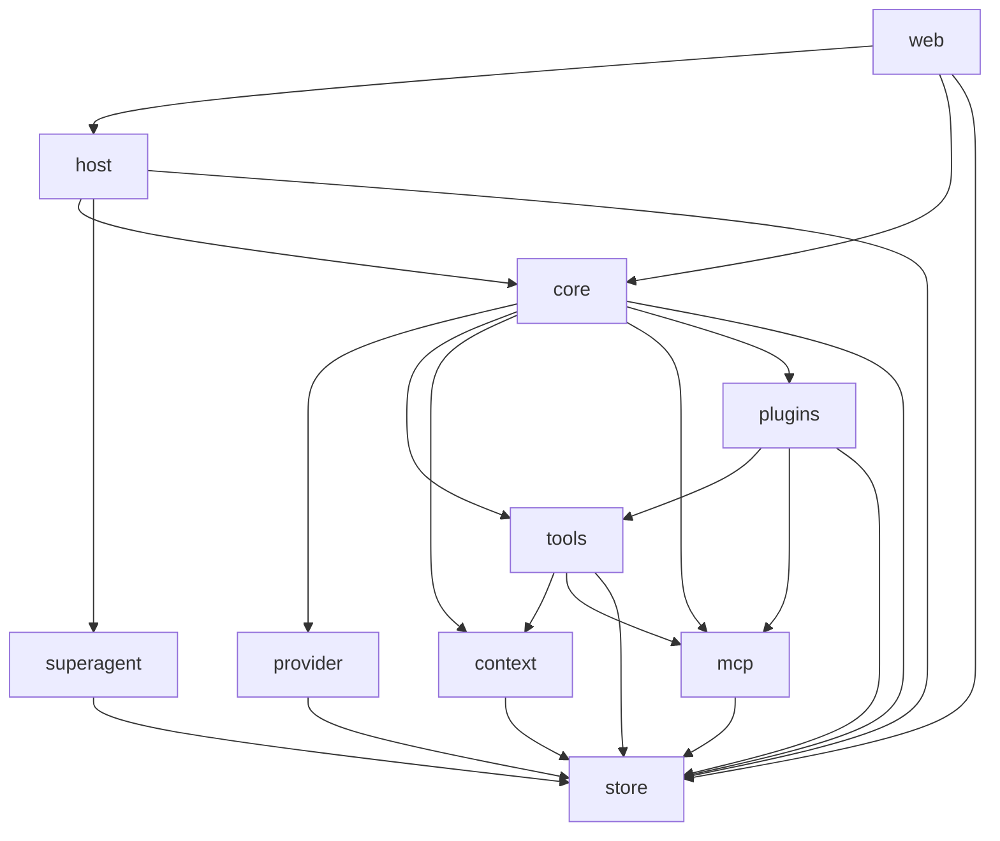

# Forge Core

Forge 是用于执行模型与工具任务的 TypeScript/Node.js 运行时，管理会话、权限审批、上下文和持久化状态。本仓提供 `@forge/core` 包与独立 HTTP/WebSocket 服务，终端、Web 和 Android 客户端通过公共契约连接运行时。

[Forge 装配主仓](https://github.com/Ling0925/forge) · [交互式 CLI](https://github.com/Ling0925/forge-cli) · [Web UI](https://github.com/Ling0925/forge-web-ui) · [Android](https://github.com/Ling0925/forge-android)

## 主要功能

- 流式模型输出、工具执行、权限审批、取消、持久输入队列与运行中插话。
- OpenAI Chat Completions / Responses、Anthropic Messages、Gemini 协议，以及模型来源、凭据和显式路由管理。
- 工作区文件搜索与编辑、命令执行、Git 检查、文件检查点和改动记录。
- 子代理、角色配置、独立 Git worktree 与代理间答疑。
- 会话历史与分页、上下文压缩、工作记忆和长期记忆；通用后台工具任务由 `async_task` 管理，完成后可通过 host 唤醒主会话。
- `AGENTS.md` 与技能发现、LSP、[MCP](docs/MCP.md)（stdio、Streamable HTTP、Legacy SSE）；可选 `browser` 和 `officecli` 插件。
- HTTP RPC、WebSocket 事件与重放、本地 Unix socket；可选 GitHub Super-agent 和 Board 工作项后端。

## 环境要求

- Node.js 22，版本范围为 `>=22.23.1 <23`。
- pnpm `11.18.0`，与 [package.json](package.json) 一致。
- Linux 或 macOS。Windows 不受支持。
- 源码构建需要 `/usr/bin/cc` 和 Node 头文件，用于编译原生文件锁；使用 Git worktree 时需要 `git`。

## 安装、构建与运行

```sh
git clone https://github.com/Ling0925/forge-core.git
cd forge-core
pnpm install --frozen-lockfile
pnpm build
```

将工作区替换为实际存在的目录，启动 Core host：

```sh
pnpm serve --workspace /absolute/path/to/project
```

默认地址是 `http://127.0.0.1:5173`。`pnpm serve` 执行 `node dist/web/serve.js`；包也声明了指向同一入口的 `forge-core` bin。
该入口提供 HTTP RPC 和 WebSocket，未传 `--renderer` 时根路径返回 404，没有 Web UI。

| 参数 | 作用 |
| --- | --- |
| `--workspace PATH` | 必填；默认将客户端限制在该工作区 |
| `--host IP` | 监听具体 IPv4/IPv6 地址，默认 `127.0.0.1` |
| `--port PORT` | HTTP/WebSocket 端口，默认 `5173` |
| `--multi-workspace` | 允许客户端切换工作区 |
| `--socket PATH` | 为同一运行时增加 Unix socket；使用私有目录内的绝对路径 |
| `--renderer PATH` | 提供已构建 Web UI 的目录，须包含 `index.html` |
| `--super-agent` | 本次启动强制启用 Super-agent，仍须配置其必填项 |
| `--help` | 显示入口帮助 |

需要网页时，先按 [Web UI 仓库](https://github.com/Ling0925/forge-web-ui)的说明构建，再启动：

```sh
pnpm serve --workspace /absolute/path/to/project \
  --renderer /absolute/path/to/built-web-ui
```

交互式 `forge` 命令由 [forge-cli](https://github.com/Ling0925/forge-cli) 提供。要操作同一个 host 的活动任务，Core 启动时传入 `--socket`，再由 CLI 的 `attach` 连接。
客户端断开不会取消已接受的任务；停止 Core 会停止它持有的任务。共享 `FORGE_HOME` 不等于连接同一运行时。

命令行 host 使用可信局域网直连模式：访问监听地址无需设备配对，HTTP 不加密。默认监听回环地址，服务校验 Host / Origin。

包目前标记为 `private`；本地消费者可通过 `file:../forge-core` 依赖构建后的包。嵌入入口是 `createHarness`，host 装配入口是 `@forge/core/host` 的 `createHostRuntime`；公开导出以 [package.json](package.json) 为准。

## 配置要点

默认状态目录是 `~/.local/share/forge`，环境变量 `FORGE_HOME` 可覆盖；嵌入时显式传入的 `stateDir` 优先。

| 相对状态目录的路径 | 内容 |
| --- | --- |
| `settings/state.json` | 权威设置事务，包含模型来源、凭据、路由、角色配置及 Super-agent 设置 |
| `settings/config.json`、`settings/credential.json` | 旧格式兼容文件；已有 `state.json` 时不再从它们读取设置 |
| `mcp/servers.json` | MCP 注册及私密环境变量、请求头 |
| `plugins.json` | 插件配置与启用状态 |

服务可以在未配置模型时启动。开始模型任务前，通过客户端或 `HarnessService.updateSettings` 保存 endpoint、模型和凭据；RPC 方法为 `updateSettings`，配置对象放在 `input` 中。

| 键 / 输入 | 用途 |
| --- | --- |
| `settings.baseUrl`、`settings.model` | 模型服务地址与精确模型 ID |
| `settings.apiMode` | 可选：`chat-completions`、`responses`、`anthropic` 或 `gemini` |
| `apiKey` | 与 `settings` 同级的私密输入；无需认证的服务可使用空值 |
| `source` / `sources`、`route`、`agent` | 与 `settings` 同级的操作输入：单个/批量来源操作、路由组操作、角色操作 |
| `settings.defaultPermission` | `readonly`、`workspace`、`unrestricted`，新配置默认为 `workspace` |
| `settings.reasoningEffort`、`settings.maxOutputTokens` | 模型推理与输出配置 |
| `settings.requestTimeoutMs`、`settings.contextBudgetTokens` | 模型请求超时与上下文预算 |
| `settings.modelContextWindows`、`settings.defaultContextWindowTokens` | 显式上下文窗口及未知模型的回退窗口 |
| `settings.maxActiveAgents`、`settings.maxAgentDepth`、`settings.lspServers` | 子代理调度与 LSP 配置 |
| `settings.superAgent` | 下节的 Router、Worker、GitHub 与 Board 配置 |

`FORGE_BASE_URL`、`FORGE_MODEL`、`FORGE_API_KEY` 可覆盖默认模型配置；显式绑定到来源的会话继续使用该来源。公开设置返回凭据是否存在，不返回密钥。
配置字段见 [settings schema](src/shared/schemas/settings.ts)，来源与账号设置见[模型接入](docs/MODEL_ACCESS_PORT_STATUS.md)，角色见[智能体协作](docs/AGENT_COLLABORATION.md)，插件见[插件文档](docs/PLUGINS.md)。

## 架构

| 模块 | 职责 |
| --- | --- |
| `src/core` | Harness 装配、模型与工具运行循环、子代理、队列、压缩与记忆 |
| `src/provider` | 模型协议适配、目录、凭据接入与路由 |
| `src/store` | 设置、会话、检查点、记忆及工作项持久化；Board HTTP 适配 |
| `src/tools` | 文件、命令、Git、Web、LSP、MCP 等工具注册与执行 |
| `src/context` | 项目指令与技能发现、读取 |
| `src/mcp` | MCP 服务注册、传输、连接与调用 |
| `src/plugins` | 插件宿主及 browser / officecli 适配 |
| `src/superagent` | Router/Worker 调度、GitHub 事件归一化、启动补查与 outbox 执行 |
| `src/host` | controller、运行时 hub、本地传输；Super-agent/Webhook/Board 事件装配 |
| `src/web` | HTTP/WebSocket host、静态资源与 Web 网关 |
| `src/shared` | 浏览器可用的类型、schema 与客户端/服务接口契约 |

箭头表示源码的跨模块导入方向；各模块均依赖 `shared`，图中统一省略这些连线。Super-agent 通过注入的 `HarnessService` 接口使用运行时。



`shared` 不反向依赖 Node 或运行时实现；浏览器客户端使用包中明确导出的共享子路径。详细边界见[架构文档](docs/ARCHITECTURE.md)和[契约归属](docs/CONTRACT_BOUNDARIES.md)。

## Super-agent 模式

Super-agent 由 Router 会话和 Worker 会话组成。Router 将 GitHub 触发分配为新工作项、附加到已有工作项、忽略或停止；Worker 在独立 worktree 中执行并汇报结果。
Router 新建工作项时，只有关联触发中包含对 `github.login` 的 @mention、指派或审阅请求，才可直接创建工作；其余新工作先成为 Suggestion，由 `decideSuggestion` 接受后创建。

### 启用与设置

先配置模型来源并保存两个已启用的角色，分别填入 `routerProfileId`、`workerProfileId`。角色可固定来源/模型或继承默认选择；Worker 的有效权限须允许创建 worktree。
通过 `updateSettings` 的 `input.settings.superAgent` 设置下表字段；工作区、角色和 GitHub 接入信息均须配置：

| 键（相对 `superAgent`） | 用途 |
| --- | --- |
| `enabled` | 持久启用开关；或用 `--super-agent` 仅在本次启动启用 |
| `workspace` | 本地 Git 工作区，独立于 HTTP 入口的 `--workspace` 参数 |
| `routerProfileId`、`workerProfileId` | 已保存的 Router / Worker 角色 ID |
| `github.login`、`github.repos` | 接收任务的 GitHub 用户及仓库列表，如 `["owner/repo"]` |
| `github.webhook.port`、`github.webhookSecret` | Webhook 独立监听端口与验签 Secret，均必填 |
| `github.webhook.host`、`github.webhook.maxBodyBytes` | 可选监听地址和请求体配置 |
| `maxWorkers` | 可选 Worker 并发数 |

保存设置后重启 host，使引擎和监听器按新配置装配：

```sh
pnpm serve --workspace /absolute/path/to/project --super-agent
```

### GitHub Webhook

在宿主机安装 GitHub CLI 并执行 `gh auth login`。启动补查及审批后的发送执行器通过 `gh auth token` 获取凭据。
在 GitHub Webhook 中填写指向独立监听器根路径的 URL，Content type 选 `application/json`，Secret 与 `github.webhookSecret` 相同；公开设置仅返回 `hasWebhookSecret`。

- 接收 Issues、Issue comments、Pull requests、Pull request reviews、Pull request review comments。
- 使用原始请求体和 Secret 校验 `X-Hub-Signature-256` 的 HMAC-SHA256；持久化后返回 202，同一 `X-GitHub-Delivery` 重复投递返回 409。
- 启动先恢复未处理 delivery，再按每仓库游标分页补查 issue events 和 issue comments；这是一次性补查，没有定时轮询。首次没有游标时从当前时间开始，不导入旧历史。

Webhook 与 Forge API 是两个监听器；对外转发 Webhook 时使用 `github.webhook.port`。

### Outbox 审批

Worker 调用 `superagent_send` 提议的评论、标签、push 和 PR 创建先保存为 pending outbox。
通过 `listOutbox` 查看，调用 `decideOutbox { outboxId, approve: true }` 后才执行；`approve: false` 拒绝发送。执行结果记录为 `sent` 或 `failed`。
Worker 的命令使用独立 `GH_CONFIG_DIR`，移除 GitHub token/host 环境变量并清空 Git credential helpers；Router 和普通会话保留原有命令环境。

`getSuperAgentState`、`listSuperAgentTriggers`、`listWorkItems`、`getWorkItem`、`listSuggestions` 提供状态查询；`stopWorkItem { workId, reason }`、`resumeWorkItem { workId }` 管理工作项。字段与事件契约见 [superagent](src/shared/superagent.ts) 和 [RPC schema](src/shared/ipc.ts)。

### 可选 forge-board 后端

默认使用本地工作项存储；[forge-board](https://github.com/Ling0925/forge-board) 可通过 HTTP 接管新工作项：

- 将 `superAgent.workItems.backend` 设为 `board`。
- 配置 `superAgent.board.url`、`projectId`、`accountable`（负责人 ID），通过 `updateSettings` 的 `input.settings.superAgent.board.token` 写入 token；公开设置仅返回 `hasToken`。新增 Board 配置后重启 host。
- Board 项目须启用 `allowAgentCancel: true` 才允许 Forge 直接取消工作项；取消仍受 Board 的审批策略约束。
- host 订阅 Board SSE，将外部审批与任务变更同步给引擎；断线后从 1 秒开始指数退避重连，每次连接失败后延迟翻倍，上限为 1 分钟，连接成功后重置为 1 秒。
- 切换后端只影响新工作项；已有本地工作项仍留在本地，由原存储继续处理，不自动迁移。

Board 的任务状态审批与 GitHub outbox 发送审批分别处理。实现见 [Board 适配器](src/store/board.ts)、[后端选择](src/store/work-items.ts)与[事件订阅](src/host/board-events.ts)。

## 开发

```sh
pnpm install --frozen-lockfile
pnpm build
pnpm test:package
pnpm exec vitest run tests/shared/contract-boundaries.test.ts tests/web-host.test.ts tests/web-static.test.ts
pnpm typecheck
pnpm lint
```

`pnpm test` 运行完整 Vitest 套件；日常修改按模块选取测试。`pnpm lint` 使用 Biome 检查代码与格式。
启动和集成检查使用临时 `FORGE_HOME` 与临时工作区，结束后清理；包测试使用离线 Provider。

## 文档

- [ROADMAP.md](ROADMAP.md)：路线图与待决事项。
- [ARCHITECTURE.md](docs/ARCHITECTURE.md)：模块职责与运行时架构。
- [CONTRACT_BOUNDARIES.md](docs/CONTRACT_BOUNDARIES.md)：共享契约与浏览器边界。
- [PROJECT_CONTEXT.md](docs/PROJECT_CONTEXT.md)：项目指令与技能发现规则。
- [AGENT_COLLABORATION.md](docs/AGENT_COLLABORATION.md)：角色、跨供应商派发与答疑。
- [RUNTIME_LIFECYCLE.md](docs/RUNTIME_LIFECYCLE.md)：运行、取消与资源所有权。
- [SESSION_STORAGE.md](docs/SESSION_STORAGE.md)：增量会话存储与恢复。
- [INPUT_QUEUE.md](docs/INPUT_QUEUE.md)：持久输入队列与恢复语义。
- [MEMORY.md](docs/MEMORY.md)：长期记忆与聚焦整理。
- [ASYNC_TOOLS.md](docs/ASYNC_TOOLS.md)：后台工具任务及完成通知。
- [MCP.md](docs/MCP.md)：传输、注册与启用、工具发现、权限和结果处理。
- [PLUGINS.md](docs/PLUGINS.md)：browser、officecli 插件配置与使用。
- [HARNESS_ADAPTATION.md](docs/HARNESS_ADAPTATION.md)：可选 Harness² 策略预检。
- [MODEL_ACCESS_PORT_STATUS.md](docs/MODEL_ACCESS_PORT_STATUS.md)：模型接入实现、迁移与验证范围。
- [MODEL_ACCESS_TS_PLAN.md](docs/MODEL_ACCESS_TS_PLAN.md)：2026-10-20 模型接入历史设计。
- [ERROR_DIAGNOSTICS.md](docs/ERROR_DIAGNOSTICS.md)：模型、客户端和工具错误诊断。
- [TEST_OWNERSHIP.md](docs/TEST_OWNERSHIP.md)：测试归属与跨仓边界。
- [AUTHORSHIP.md](docs/AUTHORSHIP.md)：作者与来源记录。

## 许可证

本仓没有项目级 `LICENSE` 文件，[package.json](package.json) 也未声明 `license`。
[THIRD_PARTY_NOTICES.md](THIRD_PARTY_NOTICES.md) 保留了 Magpie 改编部分的来源和 MIT 许可文本；这不是 Forge Core 整仓的许可证声明。
